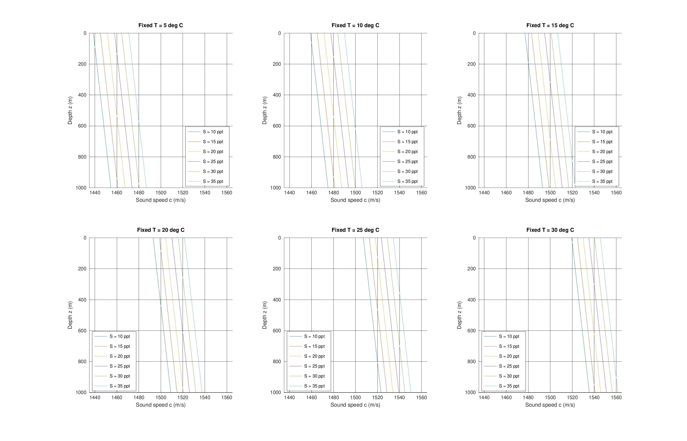
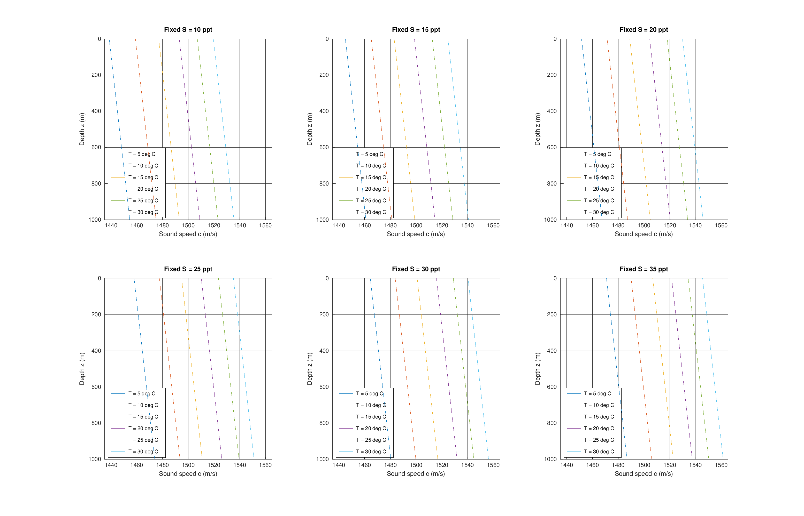
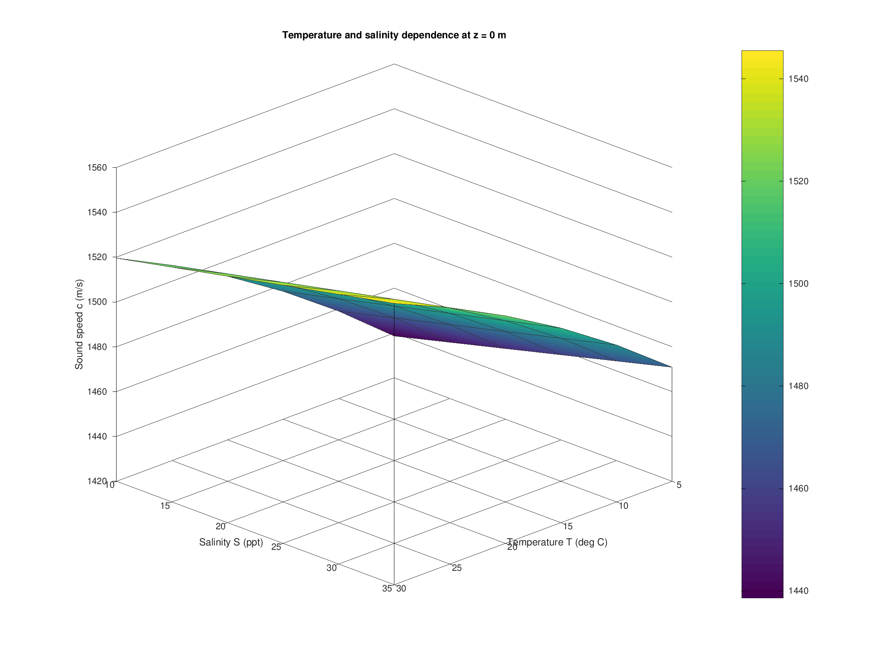

# 第二题：海水声速对温度、盐度和深度的依赖

## 1. 题目与计算方案

按题目给定公式计算：

\[
c(T,S,z)=1449.2+4.6T-0.055T^2+0.00029T^3+(1.34-0.01T)(S-35)+0.016z.
\]

其中，c 的单位为 m/s，T 为摄氏温度（°C），S 按题目采用 ppt，z 为向下为正的深度（m）。本题按给定数值使用 ppt，不把它与现代实用盐度或绝对盐度无条件等同。

温度取 T = 5:5:30 °C，即 5、10、15、20、25、30 °C；盐度取 S = 10:5:35 ppt，即 10、15、20、25、30、35 ppt，共 36 组温盐组合。**题目未给出深度范围，本解答自行取 z = 0:10:1000 m**，需要时可直接修改主程序中的 z 向量。

计算遵循控制变量法：每一条曲线中的温度和盐度固定，仅改变深度。这是为了分离各因素的影响，不代表真实海水的温盐随深度分布。

## 2. MATLAB 程序与图表

源码见 `matlab/seawater_sound_speed.m` 和 `matlab/analyze_sound_speed.m`。在 MATLAB 中将当前目录设为仓库根目录后运行：

```matlab
run('matlab/analyze_sound_speed.m')
```

不需要额外工具箱。程序计算全部温盐深组合，生成以下图表和数值表：

- 图 1：六个固定温度子图，每图用六条曲线表示不同盐度下 c 随 z 的变化。
- 图 2：六个固定盐度子图，每图用六条曲线表示不同温度下 c 随 z 的变化。
- 图 3：z = 0 m 时的声速随温度、盐度变化的曲面。
- CSV 表：36 组温盐组合在 z = 0 和 1000 m 的声速，以及对应偏导数。

图 1、图 2 横轴为声速、纵轴为深度，深度从上向下增大，符合海洋剖面的常用表示方法。所有深度剖面使用相同坐标范围，便于比较。







## 3. 数值结果

z = 0 m 时的声速如下（m/s，保留两位小数；完整计算不提前取整）：

| T（°C）\ S（ppt） | 10 | 15 | 20 | 25 | 30 | 35 |
|---|---:|---:|---:|---:|---:|---:|
| 5 | 1438.61 | 1445.06 | 1451.51 | 1457.96 | 1464.41 | 1470.86 |
| 10 | 1458.99 | 1465.19 | 1471.39 | 1477.59 | 1483.79 | 1489.99 |
| 15 | 1477.05 | 1483.00 | 1488.95 | 1494.90 | 1500.85 | 1506.80 |
| 20 | 1493.02 | 1498.72 | 1504.42 | 1510.12 | 1515.82 | 1521.52 |
| 25 | 1507.11 | 1512.56 | 1518.01 | 1523.46 | 1528.91 | 1534.36 |
| 30 | 1519.53 | 1524.73 | 1529.93 | 1535.13 | 1540.33 | 1545.53 |

在 z = 1000 m 时，上表每个值都增加 16 m/s。例如：

- c(10,35,0) = 1489.99 m/s，c(10,35,1000) = 1505.99 m/s。
- 所选范围内最小值为 c(5,10,0) = 1438.61125 m/s。
- 所选范围内最大值为 c(30,35,1000) = 1561.53 m/s。

## 4. 依赖关系及结果讨论

### （1）深度的影响

\[
\frac{\partial c}{\partial z}=0.016\ \mathrm{s^{-1}}.
\]

固定温度和盐度时，声速与深度成线性关系：每增加 100 m，声速增加 1.6 m/s；每增加 1000 m，增加 16 m/s。图中的全部声速—深度曲线均为相互平行的直线。横轴用 c、纵轴用 z 时，线条向右下方延伸；0.016 表示 dc/dz，并不是该坐标摆放下的几何斜率 dz/dc。

这一深度项可理解为经验式对压力随深度增加所产生影响的近似描述，不能据此认为所有实际海洋剖面都是线性的。

### （2）温度的影响

\[
\frac{\partial c}{\partial T}=4.6-0.11T+0.00087T^2-0.01(S-35).
\]

在本题温盐范围内，该偏导数为正，范围为 2.083–4.32175 m·s⁻¹·°C⁻¹。因此温度升高会使声速增加，固定盐度子图中，高温曲线位于低温曲线右侧。

\[
\frac{\partial^2c}{\partial T^2}=-0.11+0.00174T<0 \quad (5\le T\le30).
\]

说明随温度升高，温度对声速的边际影响逐渐减弱。相邻温度曲线并非等间距。在盐度 35 ppt 下，温度从 5 °C 升至 30 °C，声速增加 74.66875 m/s；盐度 10 ppt 时增加 80.91875 m/s。

### （3）盐度的影响

\[
\frac{\partial c}{\partial S}=1.34-0.01T.
\]

在 T = 5–30 °C 内，该偏导数为 1.29–1.04 m·s⁻¹·ppt⁻¹，始终为正。固定温度、深度时，声速随盐度线性增加，所以同一固定温度子图内，相邻盐度曲线等间距。

温度越高，盐度效应越弱：T = 5 °C 时，盐度从 10 增至 35 ppt，声速增加 32.25 m/s；T = 30 °C 时，增加 26 m/s。交叉偏导数 ∂²c/(∂T∂S) = −0.01 也反映这一点。

### （4）影响大小与模型局限

仅就本题选取的变化区间而言，温度变化带来的声速差约为 74.67–80.92 m/s，盐度变化带来的声速差为 26–32.25 m/s，深度变化带来的声速差为 16 m/s，因而本算例中温度变化效应最大。这个结论依赖于所选择的变化区间，不能直接比较具有不同单位的偏导数而给出普遍的因素重要性排序。

题目使用的是简化经验公式。本题按指定的温盐范围进行数值分析，不擅自删去低盐度点，也不因低盐度就断言其超出公式适用范围。题目未提供公式的校准范围与误差，因此结果主要用于比较各参数的影响；工程应用仍须核对公式的适用条件，并用现场实测或经过验证的模型校核。10–25 ppt 对应较低盐度水体，不代表典型外海条件。

真实海洋中的温度和盐度通常随深度变化，此时应使用全导数：

\[
\frac{dc}{dz}=\frac{\partial c}{\partial T}\frac{dT}{dz}+\frac{\partial c}{\partial S}\frac{dS}{dz}+0.016.
\]

温度下降引起的声速减小可能抵消、甚至超过压力引起的声速增加，所以真实剖面可能出现声速极小层及深海声道。不能把本题的固定温盐曲线当作真实海洋声速剖面，也不能据此认定海洋中不存在声道。工程应用还需结合温盐深实测、适用的声速模型以及声学设备校准。

## 5. 与第一题的联系

深海声学探测依赖可靠的声速信息。声速误差会影响声波传播时间与距离之间的换算，声速垂向梯度还会引起声线弯曲，进而影响多波束测深、声呐成像和水下定位。MH370 搜寻所用的海底测绘与水下声学探测，正需要将温盐深测量、声速剖面修正和设备定位结合起来。

## 6. 程序验证

已使用 GNU Octave 9.4.0 实际运行所附 MATLAB 兼容源码，成功生成 3 张图、36 行汇总数据及 3636 行剖面数据，程序中的参考值、深度增量、温盐趋势与向量化一致性断言全部通过。另用独立的十进制计算核对全部 3636 个声速值，与导出数据一致。这里验证的是 Octave 执行结果，未声称在 MATLAB 商业软件中实测。
